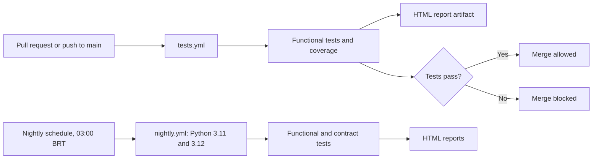

# QA Automation Portfolio


Automated API test suite in Python with pytest, running in CI on every pull request and on a nightly schedule.

## Goal
Demonstrate test automation practices end to end: API testing, test design techniques, contract testing, CI/CD and a pull request workflow with branch protection.

## Tech Stack
- Python, pytest, requests
- pytest-cov, pytest-html, pytest-xdist
- Schemathesis (OpenAPI contract testing)
- GitHub Actions

## What is tested
The target is the public [JSONPlaceholder](https://jsonplaceholder.typicode.com) API (`/posts`).
- Status codes (200, 201, 404), response structure and schema
- Negative cases and boundary values (ids 0, 1, 100, 101, 9999), using boundary value analysis and equivalence partitioning
- Contract tests generated from `openapi.yaml`

## Getting Started
```bash
python3 -m venv .venv
source .venv/bin/activate
pip install -r requirements.txt
pytest -m "not contract"      # functional tests
pytest -m contract            # contract tests
pytest --cov=api              # with coverage
```
The base URL can be overridden with the `BASE_URL` environment variable.

## Project Structure
```
.github/workflows/   CI pipelines (tests.yml, nightly.yml)
api/                 API client (posts_client.py)
tests/               functional tests, contract tests, fixtures
utils/               reserved for shared helpers
openapi.yaml         minimal OpenAPI contract for the posts endpoints
pytest.ini           markers and pytest settings
```

## CI/CD Pipeline


## Test Layers
- **Functional API tests** (`tests/test_posts.py`): run on every pull request.
- **Contract tests** (`tests/test_contract.py`): generated by Schemathesis from `openapi.yaml` for the GET operations. Run nightly. POST is covered by the functional tests, since the demo API simulates writes.
- **Nightly run:** daily via GitHub Actions on Python 3.11 and 3.12, with HTML reports as artifacts.

## Design Decisions
- **Branch protection:** `main` only accepts pull requests with a passing CI check. I validated it by pushing an intentionally failing test and confirming the merge was blocked.
- **Fast PR pipeline:** contract tests run nightly, so pull requests stay quick.
- **Contract scope:** GET operations only, because the demo API accepts invalid input and simulates writes.
- **Excluded check:** the undeclared-method check (ST204) is disabled, because the TRACE 405 response comes from the CDN in front of the demo API, not from the API itself.

## Known Limitations
- The target is a third-party demo API, so tests depend on an external service.
- POST responses are simulated by the API, so persistence cannot be verified.
